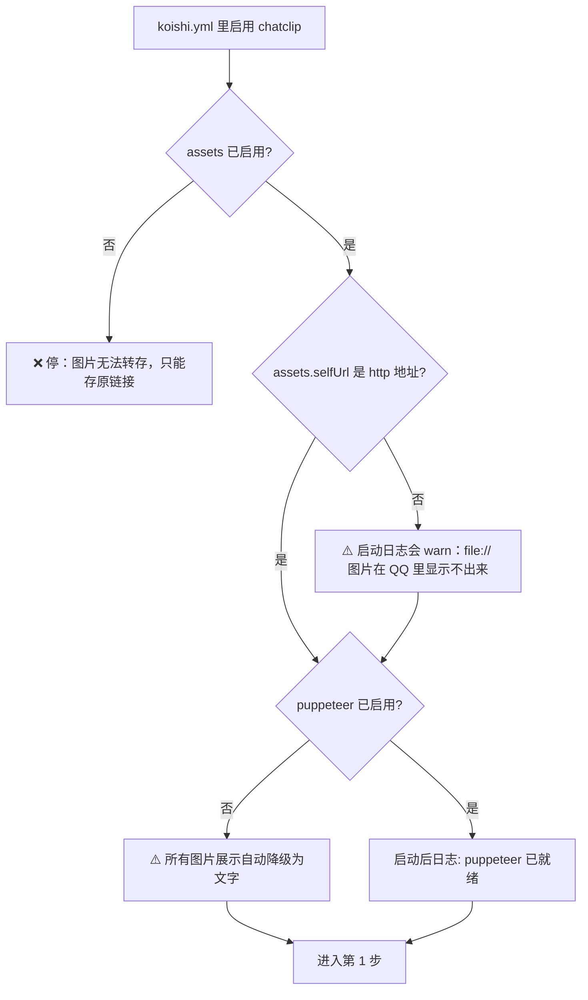
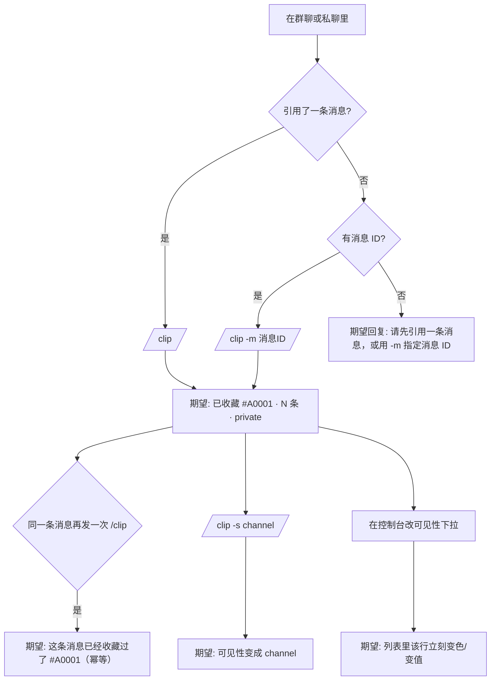
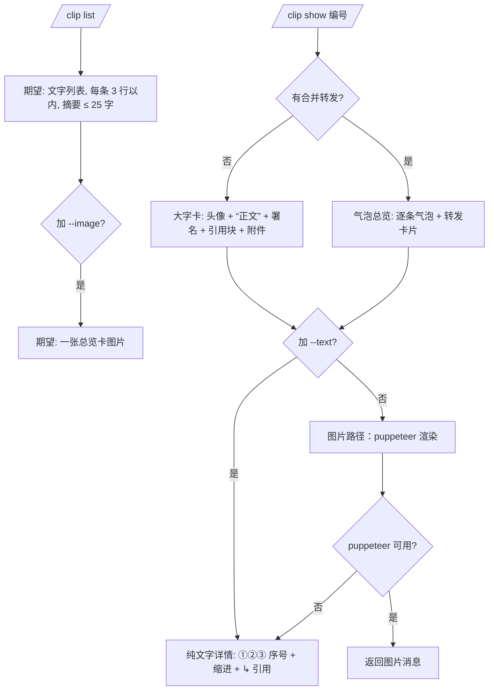
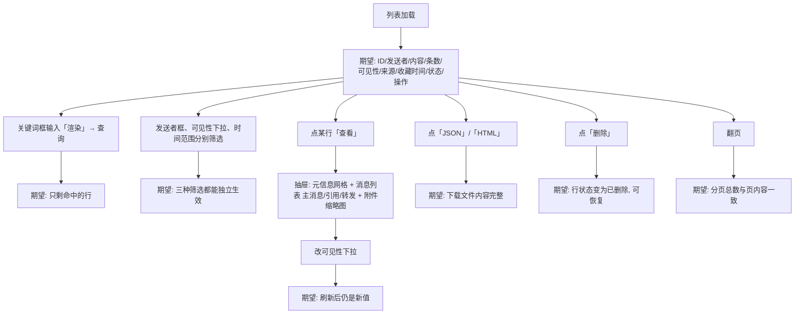

# chatclip 全命令验证流程

这份清单覆盖插件的每一条用户可见路径：收藏、展示、检索、管理、控制台，以及各种降级。
照着箭头走一遍，任何一步的「期望」对不上就是 bug。

## 0. 环境准备



启动：`yarn dev`（仓库根），控制台 <http://localhost:5140>，沙箱页 `/sandbox` 可直接发消息。

## 1. 收藏路径



| 步骤 | 操作 | 期望 |
| --- | --- | --- |
| 1.1 | 引用一条纯文字消息，发 `/clip` | 回复 `已收藏 #A0001 · 1 条 · private` |
| 1.2 | 引用一条带图消息，发 `/clip` | 条数为 1，控制台详情里能看到附件缩略图 |
| 1.3 | 引用一条**合并转发**，发 `/clip` | 气泡形态，条数 = 主消息 + 展开的转发条数 |
| 1.4 | 重复 1.1 | 回复「已经收藏过了」，不新增行 |
| 1.5 | `/clip -m <真实消息ID>` | 不引用也能收藏成功 |
| 1.6 | `/clip -m 999999999` | 回复「请先引用一条消息，或用 -m 指定消息 ID」 |
| 1.7 | `/clip -s public` | 回复里可见性是 public |
| 1.8 | `/clip -s foo` | 回复「可见性只能是 private、channel 或 public」 |

## 2. 展示形态



| 步骤 | 操作 | 期望 |
| --- | --- | --- |
| 2.1 | `/clip list` | `📚 我的收藏 · 共 N 条 · 第 1/1 页`，行首 `#A0001 · 昵称 · 今天 22:03 · 仅自己` |
| 2.2 | `/clip list 2` | 到第 2 页；没有第 2 页时回到第 1 页并正常渲染 |
| 2.3 | `/clip list --image` | 收到图片；卡片标题「我的收藏」 |
| 2.4 | `/clip show #A0001`（单条、无转发） | 大字卡，正文末尾有闭合引号 `”` |
| 2.5 | `/clip show #A0002`（有转发） | 气泡总览 |
| 2.6 | `/clip show #A0001 --card` / `--bubble` | 强制形态生效 |
| 2.7 | `/clip show #A0001 --text` | 纯文字详情，含 `①②③`、两空格缩进、`↳ 引用` |
| 2.8 | 停掉 puppeteer 后 `/clip show #A0001` | 自动降级为文字，不报错 |
| 2.9 | `/clip show 999` | `找不到收藏 #A0999。` |

## 3. 检索与筛选

| 步骤 | 操作 | 期望 |
| --- | --- | --- |
| 3.1 | `/clip search 渲染` | 只列出正文命中的收藏；标题 `🔍 「渲染」` |
| 3.2 | `/clip search zzz` | `📭 没有找到包含「zzz」的收藏。` |
| 3.3 | `/clip list --from 白露` | 只出现昵称为「白露」的收藏 |
| 3.4 | `/clip list --from 白露,张三` | 两个发送者的收藏都出现 |
| 3.5 | `/clip list --since 7d` | 只出现 7 天内收藏的 |
| 3.6 | `/clip list --since 2026-11-01 --until 2026-11-20` | 只出现在这个区间内的 |
| 3.7 | `/clip list --here` | 只出现本群收藏 |
| 3.8 | `/clip list --all` | 只出现 public 收藏 |
| 3.9 | 换个账号 `/clip list` | 看不到别人的 private 收藏 |

## 4. 管理与导出

| 步骤 | 操作 | 期望 |
| --- | --- | --- |
| 4.1 | 本人 `/clip rm #A0001` | `已删除 #A0001。`；列表里消失 |
| 4.2 | 非本人 `/clip rm #A0001` | `只有收藏者本人或管理员可以删除。` |
| 4.3 | `/clip export #A0002` | 返回 `` ```json `` 代码块，含 clip + messages + attachments |
| 4.4 | `/clip export #A0002 --html` | 返回 HTML 源码 |
| 4.5 | 对超大收藏 `/clip export` | `导出内容太大，请在控制台「聊天收藏」页面导出。` |
| 4.6 | `/clip help` | 完整指令表，中文无截断，`<...>` 不会被吃掉 |
| 4.7 | `/clip h`（别名） | 同上 |

## 5. 控制台

打开 <http://localhost:5140/chatclip>：



## 6. 自动化回归

```bash
# 采集 → 落库 → 幂等 → 转发 → 查询 → 文字 → 图片，全链路
node -r esbuild-register scripts/smoke.ts

# filter 自引用保护（RangeError 回归）
node -r esbuild-register scripts/filter-guard.ts

# 用真实库渲染某条收藏到图片
node -r esbuild-register scripts/render-one.ts 5 .preview/card.png

# 控制台截图 / 详情抽屉截图（需要先启动实例）
node scripts/shot.mjs http://127.0.0.1:5140/chatclip .preview/console.png
node scripts/shot-detail.mjs '#A0001' .preview/detail.png

# 控制台交互（关键词筛选、可见性筛选、导出 JSON 下载）
node scripts/e2e-console.mjs
```

全部脚本退出码为 0 即通过。渲染产物写到 `.preview/`，已在 `.gitignore` 里。

## 7. 已知的坑（复测时优先怀疑）

| 现象 | 原因 | 处理 |
| --- | --- | --- |
| 命令报 `RangeError: Maximum call stack size exceeded` | loader 的 `$filter` 包装自引用（`@koishijs/loader/src/shared.ts:349`），常见于控制台改配置后热重载 | 本插件已用 `protectFilter` 兜底；重启 koishi 可彻底清除 |
| `clip list` 却执行了 `/clip` 的收藏逻辑 | 根命令声明了位置参数，koishi 的命令解析不再往下匹配子命令（`@koishijs/core` 的 `inferCommand`） | 根命令不能带位置参数，按 ID 收藏请用 `-m` |
| 回复里的 `<消息ID>` 消失 | 发送前 `h.normalize` 把尖括号当元素解析 | 提示文案里不要写尖括号 |
| 图片显示不出来 | `assets.selfUrl` 为 `file://` 或未配置 | 配成 `http://localhost:5140` |
| prod 模式控制台 403 | 工作区软链接 + 控制台静态路由的路径校验（`@koishijs/plugin-console/src/node/index.ts:146`） | 本地用 `yarn dev`；发布安装后正常 |
